<h1 align="center">Baton</h1>

<p align="center"><strong>Every request has an owner.</strong></p>

<p align="center">
  The real-time operations coordination platform for event teams, built on Nexconn Chat and Call.<br>
  <a href="https://baton.priyanshnarang.in">Live app</a> ·
  <a href="https://youtu.be/Cyq-dWpizs0">Demo video</a> ·
  <a href="#run-it-locally">Run locally</a> ·
  <a href="#nexconn-integration">Nexconn integration</a>
</p>

<p align="center">
  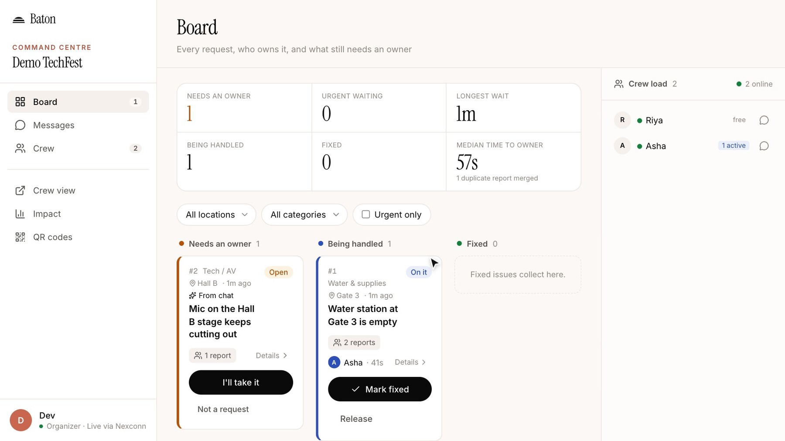
</p>

## The problem

Campus fests, hackathons and meetups are run by small volunteer crews coordinating in one group chat. That chat spreads information well but is bad at getting work done:

- **No owner.** Everyone sees the request; each person assumes someone else has it.
- **Duplicates.** The same issue arrives five times from five people.
- **Silent handovers.** A volunteer leaves and the job quietly drops.
- **No closure.** The person who reported the problem never hears back.

Baton keeps the chat and adds one rule on top of it: **every request has exactly one owner, and everyone can see who.**

> Baton coordinates operational requests such as supplies, equipment and logistics. It is not an emergency or safety-critical dispatch system.

## Key features

| Feature                 | What happens                                                                                                                                      |
| ----------------------- | ------------------------------------------------------------------------------------------------------------------------------------------------- |
| **QR onboarding**       | Volunteers join the crew by scanning a QR code. Attendees report from a location poster. Nobody installs an app or creates an account.            |
| **Live incident cards** | Every report becomes a numbered, categorised incident that appears on the organizer board and every crew phone without a reload.                  |
| **Chat to request**     | A request typed in crew chat ("water's out at gate 3") becomes a tracked incident, linked back to the message.                                    |
| **Duplicate merging**   | A second report about the same problem attaches to the existing incident. Matching is rule-based (location, category, keywords, recency), not AI. |
| **Atomic claim**        | One tap takes ownership. If several volunteers tap at once, exactly one wins.                                                                     |
| **Baton Pass**          | The owner offers the incident to a teammate with a note. Ownership moves only when they accept, so it is never ownerless.                         |
| **Voice huddle**        | A 1:1 audio call started from the incident, logged on its timeline.                                                                               |
| **Closed loop**         | The reporter sees "Sent", then who is on it, then "Fixed".                                                                                        |
| **Escalation**          | Unowned incidents privately re-alert the location's lead, or the event leads, after 2 minutes (45 seconds if urgent).                             |
| **Audit and impact**    | Every transition is recorded. Each incident shows time to owner and time to fix.                                                                  |

<table>
  <tr>
    <td width="33%">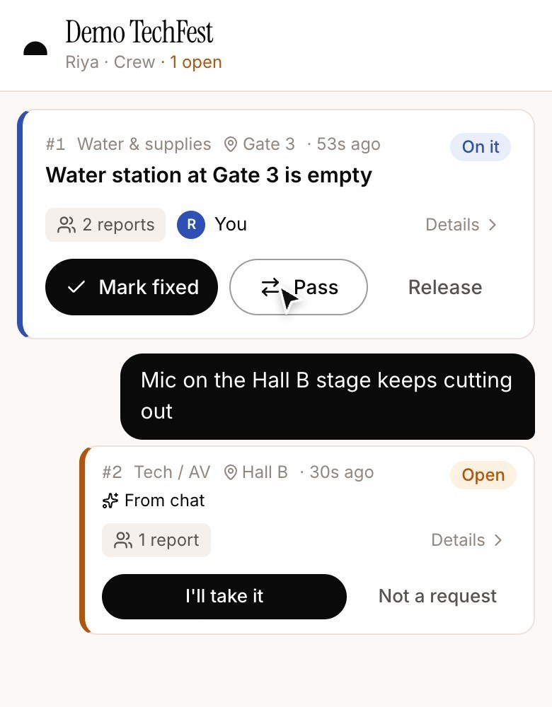</td>
    <td width="33%">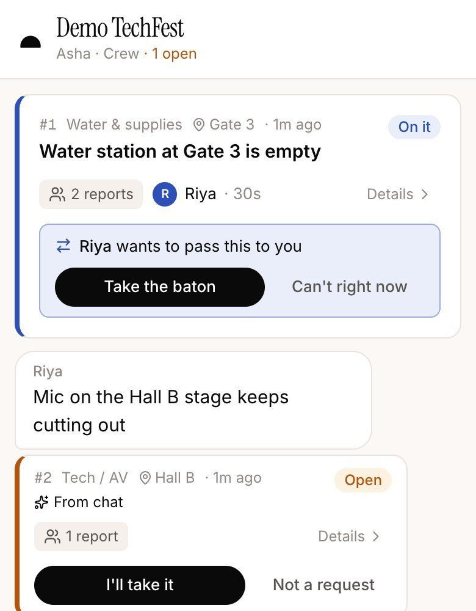</td>
    <td width="33%">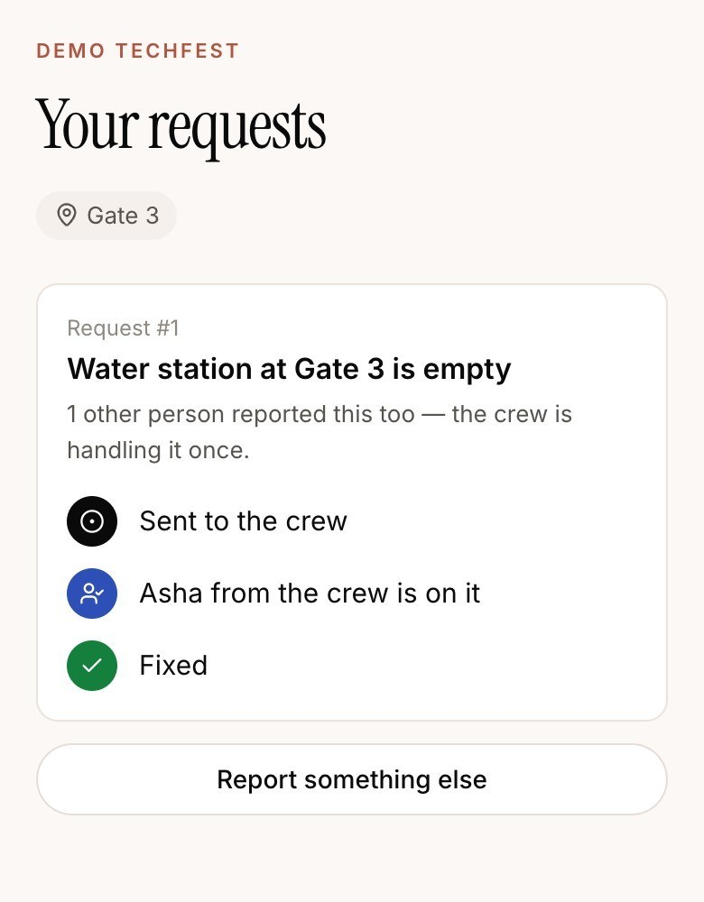</td>
  </tr>
  <tr>
    <td><sub><b>Volunteer.</b> A chat message became a request ("From chat"), now owned by this volunteer.</sub></td>
    <td><sub><b>Baton Pass.</b> Only the recipient sees the offer. The current owner keeps it until it is accepted.</sub></td>
    <td><sub><b>Attendee.</b> The reporter follows the request from "Sent" to "Fixed".</sub></td>
  </tr>
  <tr>
    <td>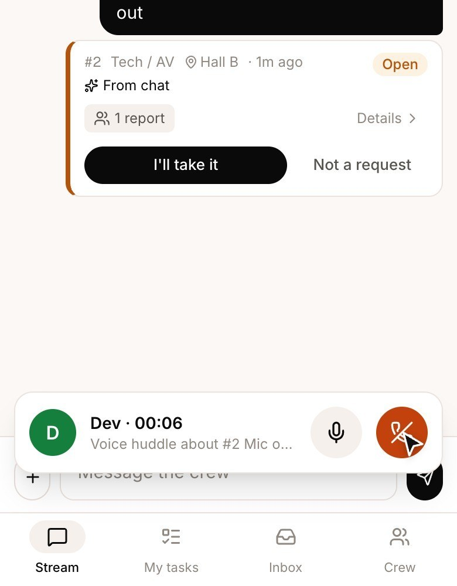</td>
    <td>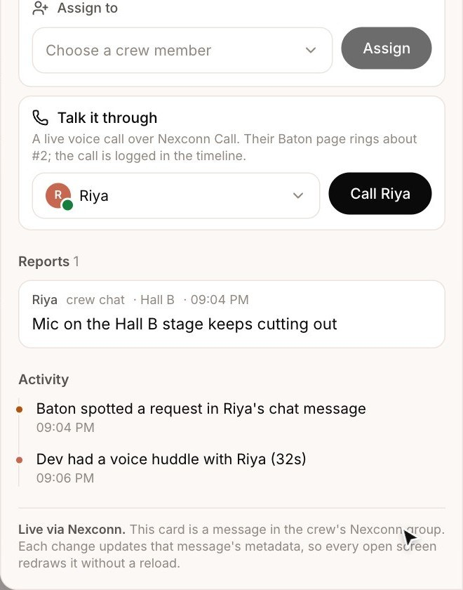</td>
    <td>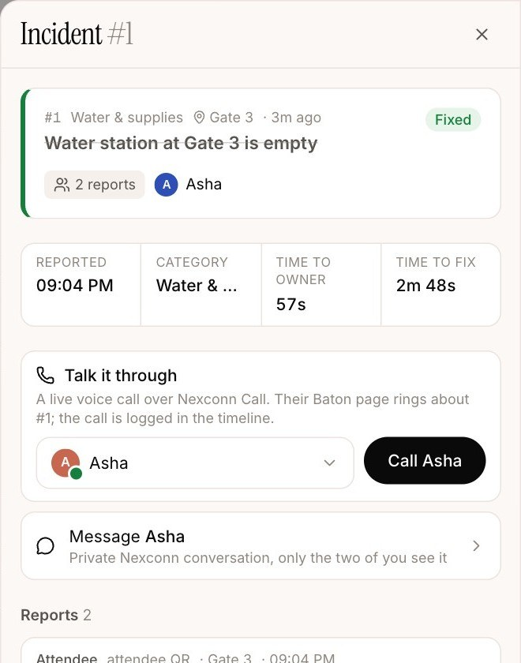</td>
  </tr>
  <tr>
    <td><sub><b>Voice huddle.</b> A Nexconn 1:1 audio call between crew members.</sub></td>
    <td><sub><b>Activity.</b> Chat detection and the call are logged on the incident.</sub></td>
    <td><sub><b>Record.</b> Two merged reports, time to owner 57 s, time to fix 2 m 48 s.</sub></td>
  </tr>
</table>

<sub>All screenshots are captures of the live app from a recorded end-to-end run on 12 Nov 2026.</sub>

## How it works

1. **Set up.** The organizer names the event and its locations at `/new`. Baton creates a Nexconn group channel for the crew and generates a crew QR code plus one report poster per location.
2. **Join.** Volunteers scan the crew code, type a name and land in the crew app.
3. **Report.** An attendee scans a poster, picks a category and sends. They get an anonymous identity and a private status thread.
4. **Coordinate.** The report becomes an incident card in the crew group. Duplicates attach to it. A volunteer claims it, can pass it, and can call a teammate from it.
5. **Close.** The owner marks it fixed. The board, every phone and the reporter update; the timeline keeps the record.

| Role             | Screen                                         | Device  |
| ---------------- | ---------------------------------------------- | ------- |
| Organizer / lead | Board, QR codes, impact (`/o/[eventId]`)       | Desktop |
| Volunteer        | Stream, my tasks, inbox, crew (`/c/[eventId]`) | Phone   |
| Attendee         | Report and status (`/e/[slug]`)                | Phone   |

The landing page also has **Try Baton live**, which creates a private, labelled demo event so you can try every role in one browser.

## Architecture

<p align="center">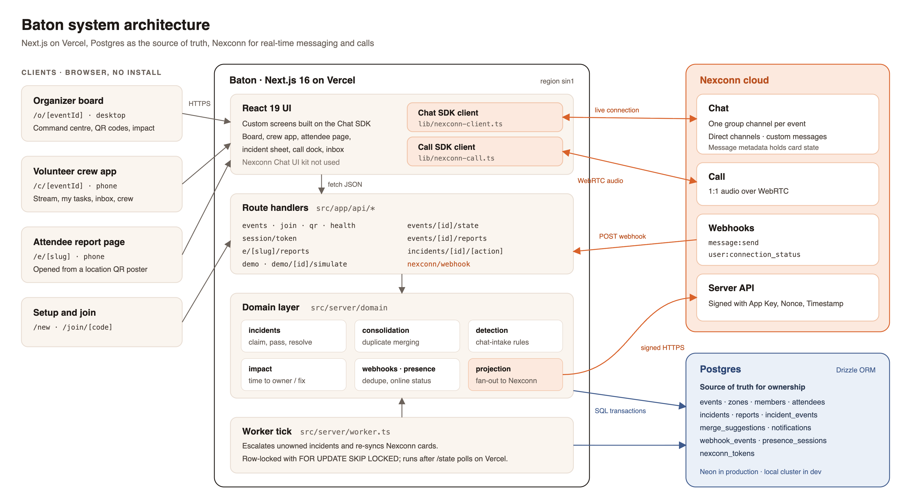</p>

- **Postgres is the source of truth.** Claims, passes, merges and resolutions are decided server-side in transactions.
- **Nexconn is the delivery layer.** After a change commits, the projection step updates the incident's card in Nexconn, and every connected client receives it.
- **Clients never hold secrets.** Browsers get a short-lived Nexconn access token from `/api/session/token`; the App Secret is only used on the server.

### Technology

| Layer              | Choice                                                                                             |
| ------------------ | -------------------------------------------------------------------------------------------------- |
| App                | Next.js 16 (App Router), React 19, TypeScript                                                      |
| Styling and motion | Tailwind CSS 4, Framer Motion, Radix dropdown, Lucide icons                                        |
| Data               | Postgres 16, Drizzle ORM, `postgres` driver, Zod validation                                        |
| Real time          | Nexconn Chat SDK for Web (`@nexconn/chat`, `@nexconn/engine` 26.2.1), Nexconn Server API, webhooks |
| Calls              | Nexconn Call SDK for Web (`@nexconn/call` 26.2.1)                                                  |
| Testing            | Vitest (unit and real-Postgres integration), scripted multi-user E2E                               |
| Hosting            | Vercel (`sin1`) with Neon Postgres; Dockerfile for long-running hosts                              |

## Nexconn integration

<p align="center">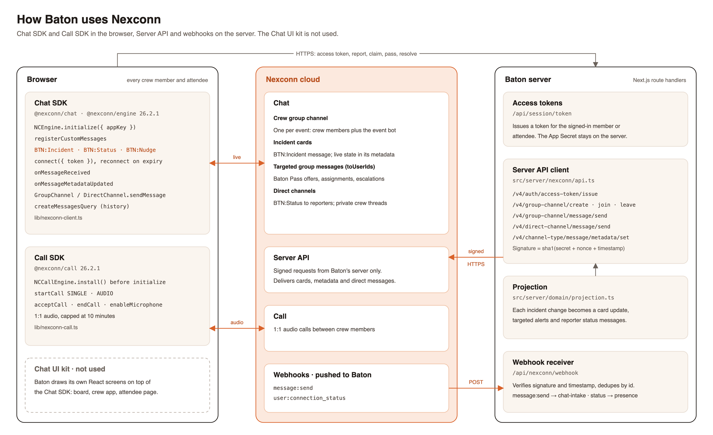</p>

Baton uses the **Chat SDK with its own React interface**. The Nexconn Chat UI kit is not used.

| Baton feature                                       | Nexconn capability                                                                                                                                   | Code                                                                       |
| --------------------------------------------------- | ---------------------------------------------------------------------------------------------------------------------------------------------------- | -------------------------------------------------------------------------- |
| Sign-in without accounts                            | Server API `POST /v4/auth/access-token/issue`                                                                                                        | `src/server/nexconn/api.ts`, `src/app/api/session/token`                   |
| One crew group per event                            | `/v4/group-channel/create`, `/join`, `/leave`                                                                                                        | `src/server/nexconn/api.ts`                                                |
| Crew chat and history                               | Chat SDK `GroupChannel.sendMessage`, `createMessagesQuery`                                                                                           | `src/lib/nexconn-client.ts`                                                |
| Incident cards                                      | Custom message types `BTN:Incident`, `BTN:Status`, `BTN:Nudge` (`NCEngine.registerCustomMessages`)                                                   | `src/lib/nexconn-client.ts`                                                |
| Live card state                                     | Message metadata: `/v4/channel-type/message/metadata/set` on the server, `onMessageMetadataUpdated` on clients, applied only if the version is newer | `src/server/domain/projection.ts`                                          |
| Private alerts (Baton Pass, assignment, escalation) | Group message with `toUserIds`                                                                                                                       | `src/server/domain/projection.ts`, `src/server/worker.ts`                  |
| Reporter status and 1:1 crew threads                | Direct channel messages (`/v4/direct-channel/message/send`, `DirectChannel`)                                                                         | `projection.ts`, `src/components/direct-thread.tsx`                        |
| Chat line → request                                 | Webhook `message:send`                                                                                                                               | `src/app/api/nexconn/webhook/route.ts`, `src/server/domain/chat-intake.ts` |
| Crew online status                                  | Webhook `user:connection_status`                                                                                                                     | `src/server/domain/presence.ts`                                            |
| Reconnect and token refresh                         | Connection status handler, `NCEngine.connect` with a fresh token                                                                                     | `src/lib/nexconn-client.ts`                                                |
| Voice huddle                                        | Call SDK `NCCallEngine.install`, `startCall` (single, audio), `acceptCall`, `endCall`, `enableMicrophone`; 10-minute cap                             | `src/lib/nexconn-call.ts`, `src/components/call-dock.tsx`                  |

Reference: [Nexconn documentation](https://docs.nexconn.ai/).

## Data model and real-time flow

<p align="center">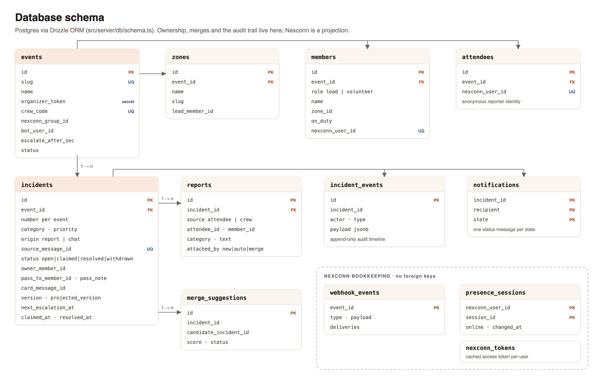</p>

- `incidents` holds ownership (`owner_member_id`), the pending Baton Pass (`pass_to_member_id`, `pass_note`) and two version counters: `version` changes on every update, `projected_version` records what has reached Nexconn.
- `incident_events` is an append-only audit trail; `notifications` guarantees one status message per reporter per state.
- `webhook_events` dedupes Nexconn deliveries; `incidents.source_message_id` is unique, so a retried chat webhook never creates a second incident.

<p align="center">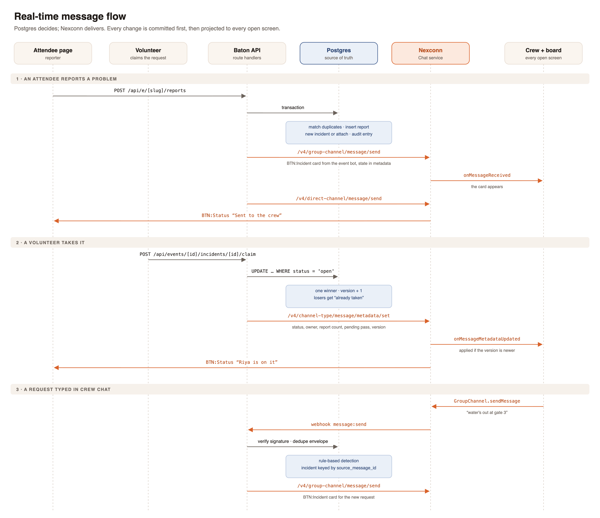</p>

## Run it locally

**Requirements:** Node 22+, a local Postgres 16 binary (Homebrew `postgresql@16` works), and a Nexconn app with Chat enabled.

```bash
npm install
npm run db:start            # project-local Postgres on :54329 (data in .pgdata/)
npm run db:migrate
cp .env.example .env.local  # then fill in SESSION_SECRET and the Nexconn keys
npm run dev
```

Open http://localhost:3000. `GET /api/health` reports which configuration is missing.

### Environment variables

| Variable                | Required | Purpose                                                             |
| ----------------------- | -------- | ------------------------------------------------------------------- |
| `DATABASE_URL`          | Yes      | Postgres connection string. Defaults to the local cluster.          |
| `SESSION_SECRET`        | Yes      | 32+ characters; signs the session cookies.                          |
| `NEXCONN_APP_KEY`       | Yes      | Public App Key from the Nexconn Console.                            |
| `NEXCONN_APP_SECRET`    | Yes      | Server-only App Secret. Never expose it to the client.              |
| `NEXCONN_DATA_CENTER`   | Yes      | `SG`, `NA` or `SA`, matching your Nexconn app.                      |
| `PUBLIC_BASE_URL`       | No       | Base URL used in QR codes. Defaults to the request origin.          |
| `DATABASE_URL_UNPOOLED` | No       | Direct URL used for migrations (e.g. Neon).                         |
| `BATON_DISABLE_WORKER`  | No       | `1` on serverless hosts; escalation then runs after `/state` polls. |
| `TEST_DATABASE_URL`     | No       | Database for `npm test`. Defaults to local `baton_test`.            |

See [`.env.example`](.env.example). Without Nexconn keys the app starts and shows a setup banner instead of failing silently.

### Nexconn Console setup

1. Create an app in the [Nexconn Console](https://console.nexconn.ai) and copy the App Key and App Secret into `.env.local`.
2. Under Chat settings, enable pre-join history access for new group members.
3. To use chat-to-request and presence, add a webhook pointing at `https://<your-host>/api/nexconn/webhook` with the events `message:send` and `user:connection_status`. Nexconn must be able to reach the URL, so use a deployed host or a tunnel.
4. To use voice huddles, enable Nexconn Call for the app.

## Testing

```bash
npm run db:migrate:test   # once: create the baton_test schema
npm test                  # Vitest: unit tests plus integration tests against real Postgres
npm run typecheck
npm run lint
npm run e2e               # multi-user scenario against http://localhost:3000
npm run e2e -- https://your-deployment.example
```

The E2E script drives an organizer, two volunteers and two attendees as separate sessions through report, merge, claim, pass and resolve. Live delivery over the Nexconn SDK and calls are checked by hand in two browsers.

## Deployment

**Vercel (current production).** `vercel.json` pins functions to `sin1` and runs `node scripts/migrate.mjs` before `next build`. Set the environment variables above plus `BATON_DISABLE_WORKER=1`, and use a hosted Postgres such as Neon. Escalations then run when a Baton page polls `/state`, so they wait until at least one page is open.

**Docker (Railway, Render, Fly).** The `Dockerfile` builds the app, applies migrations on start and runs one long-lived Node process, which also runs the escalation worker. Provide `DATABASE_URL` and the variables above at runtime; nothing secret is baked into the image.

After deploying, set `PUBLIC_BASE_URL`, point the Nexconn webhook at the new host, and check `/api/health`. More detail: [docs/DEPLOYMENT.md](docs/DEPLOYMENT.md).

## Security

- **Secrets stay on the server.** The App Secret, session secret and database URL are server-only. Browsers receive a short-lived Nexconn access token.
- **Signed sessions.** Crew and attendee identities are HMAC-SHA256-signed, per-event, per-role cookies (`httpOnly`, `sameSite=lax`, `secure` in production). Organizer access is a rotatable capability link.
- **Server-side authority.** Claims, passes, merges and resolutions are authorised and decided in database transactions. Nexconn metadata is a projection, never the source of truth.
- **Webhook verification.** Requests are checked with `sha1(AppSecret + Nonce + Timestamp)` in constant time and rejected outside a 5-minute window. The signature does not cover the body, so payloads are treated as hints and deduped by event id.
- **Privacy.** Attendees are anonymous. Presence storage drops the client IP.
- **Abuse limits.** Report, join and demo endpoints are rate-limited per client.

Report a vulnerability privately to the maintainer rather than in a public issue.

## Contributing

1. Fork and create a branch from `main`.
2. Run `npm run db:start` and `npm run db:migrate:test`, then make your change with tests next to the code (`*.test.ts`).
3. Before opening a pull request, run `npm test`, `npm run typecheck`, `npm run lint` and `npm run build`.
4. For schema changes, edit `src/server/db/schema.ts` and run `npm run db:generate` to add a migration.
5. Never commit `.env.local` or real credentials.

Keep pull requests focused and describe how you tested them.

## Project status

Baton was built during the Nexconn Build Challenge 2026 (first commit 28 Oct 2026). It has been verified end to end on the live site. It has no external pilots or users yet.

| Known limitation   | Detail                                                                                                                                    |
| ------------------ | ----------------------------------------------------------------------------------------------------------------------------------------- |
| Latency            | Some actions take a few seconds because of database round trips across regions.                                                           |
| Calls              | 1:1 audio only.                                                                                                                           |
| Duplicate matching | Rule-based; reports worded very differently can be missed. Sensitive categories are only suggested as merges, never merged automatically. |
| Chat features      | No read receipts or typing indicators.                                                                                                    |

The landing hero is adapted from an Originkit block and the footer from Watermelon's footer-29.
