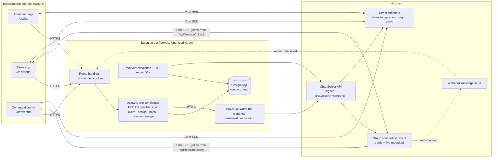

# Baton — Architecture

_Last verified against the code on 12 Nov 2026. Everything below exists in the repository unless it is marked **Not built**._

## 0. Baton ↔ Nexconn at a glance

The App Secret exists only in the server box. Browsers hold the public App Key and their own user token.

## 1. Sources of truth

| Concern | Owner |
|---|---|
| Events, zones, crew, attendees, incidents, reports, ownership, audit trail, notification dedupe | **PostgreSQL** (authoritative) |
| Crew group chat, incident cards, attendee status updates, escalation and assignment alerts, organizer ↔ volunteer conversations | **Nexconn Chat** (one group channel per event, plus direct channels) |
| Live incident state on every phone | **Nexconn message metadata** on the incident card, written only by our server |
| UI state | React |

The rule: a state change is settled in Postgres first, inside one conditional `UPDATE`, and only then projected to Nexconn. If Nexconn is slow or down, the app is still correct; phones re-read `/state` on reconnect, and a repair loop re-projects anything that failed.

## 2. Runtime

- **One Next.js 16 app** (App Router, TypeScript, Turbopack) running as a long-lived Node server. It must be long-lived because `src/instrumentation.ts` starts two background loops in `src/server/worker.ts`: escalations every 10 s and reconciliation every 60 s. A serverless host would need these moved to a cron.
- **Data:** Drizzle ORM with the `postgres` driver; migrations in `drizzle/`; schema in `src/server/db/schema.ts`.
- **Local development:** a project-local Postgres cluster on port 54329, plus a separate `baton_test` database for vitest.
- **Nexconn Server API:** a small signed client in `src/server/nexconn/api.ts`. The signature is `sha1(AppSecret + Nonce + Timestamp)`; it fails over from primary to backup domain with a 5 s timeout.
- **Nexconn Web SDK:** `@nexconn/engine` and `@nexconn/chat`, pinned to 26.2.1. A single wrapper, `src/lib/nexconn-client.ts`, initialises once, registers the three custom message types, connects once, and fans events out to React.

## 3. Trust boundaries

- **Browser:** holds the public App Key and that person's own Nexconn token, issued by `/api/session/token` only for a valid session. The App Secret never leaves the server.
- **Server environment:** `NEXCONN_APP_KEY`, `NEXCONN_APP_SECRET`, `DATABASE_URL`, `SESSION_SECRET`, `PUBLIC_BASE_URL`. `.env.example` lists names only.
- **Webhooks** (`/api/nexconn/webhook`):
  - The signature check covers only nonce and timestamp, not the body, so it is combined with a ±5 minute freshness window and dedupe on the envelope id (`webhook_events`).
  - The payload is treated as a hint: the sender must be a crew member of the event that owns the group, otherwise it is ignored.
  - The route answers quickly and projects inside `after()`.
- **Requests:** every request body is parsed with zod; every route resolves the caller from a signed cookie and checks it belongs to the event in the URL.

## 4. Identity (no accounts)

- **Sessions:** one HMAC-signed, HTTP-only cookie per role and event (`baton_o_…`, `baton_m_…`, `baton_a_…`), so one browser can hold the organizer, crew and attendee views of the same event, as the demo needs.
- **Organizer:** creating an event makes the organizer the first crew lead and sets the organizer cookie. A secret organizer link (`/enter/:eventId?k=…`) restores it on another device.
- **Crew:** joins with the crew code (QR or link) and a name; no phone or email.
- **Attendees:** anonymous; a cookie ties their reports to them so they can see status.
- **Nexconn user ids:** random and never sequential: `c_…` (crew), `a_…` (attendees), and a per-event bot user that sends cards and alerts.

## 5. Data model (Postgres)

`events` · `zones` · `members` (role lead|volunteer, `is_simulated`) · `attendees` · `incidents` (status open|claimed|resolved|withdrawn, owner, pending pass, `version`, `report_count`, escalation level and next time, card message id, projection flag) · `reports` (source attendee|crew|chat, `source_message_id` unique) · `merge_suggestions` · `incident_events` (append-only audit) · `notifications` (primary key `incident, recipient, state`: one status message per person per state) · `webhook_events` · `nexconn_tokens`.

## 6. Core flows

1. **Attendee report:** `POST /api/e/:slug/reports`.
   - In one transaction, `consolidation.decide()` returns one of: attach to an open incident (same zone and category within the window), suggest a merge (text similarity; never automatic for medical or safety), or create a new incident.
   - Effects: create the card, or update its metadata (`n`, `v`); send the attendee a status message.
2. **Crew chat message becomes a request.**
   - The client path is `POST /api/events/:id/chat-requests`; the webhook path is `message:send`, routed to `chat-intake.handleMessageSend`.
   - `detection.detectRequest()` uses transparent rules (need/broken/missing patterns, zone names, category keywords); there is no model call.
   - The unique `source_message_id` makes the conversion idempotent across webhook retries and client calls. The original message gets `inc` metadata, so it renders as a claimable card. Undo withdraws the incident.
3. **Claim, release, resolve, merge, reopen, assign:** `POST /api/events/:id/incidents/:incidentId/:action`.
   - A version-checked conditional `UPDATE … WHERE status = … AND version = …` runs. Zero rows means 409 with the current owner, so exactly one simultaneous claim wins.
   - Each action appends an `incident_events` row and returns effects.
4. **Assignment:** lead only.
   - The assignee must be an active member, and the incident must not be resolved or withdrawn.
   - Assigning to the current owner is a no-op.
   - The assignee gets a targeted group message (`BTN:Nudge`, `kind: "assigned"`) that only they receive. It is skipped if the incident has moved on by send time.
5. **Baton Pass** (`offerPass`, `acceptPass`, `endPass`):
   - Only the owner can offer, to one active crew member. The offer is stored on the incident (`pass_to_member_id`, `pass_note`, `pass_offered_at`); **the owner stays the owner** while it is pending.
   - Accepting is one conditional `UPDATE … WHERE status='claimed' AND owner=<offerer> AND pass_to=<me>`, so a release, reassignment or fix that lands first makes the accept fail instead of overwriting it. There is no moment with no owner (race-tested in `incidents.test.ts`).
   - Decline keeps the owner and tells them; the owner (or a lead) can cancel. Release, resolve and assign void a pending pass.
   - Projection: card metadata `pass` / `passN` shows "passing to …" on every phone, and a targeted `BTN:Nudge` (`kind: pass_offered | pass_accepted | pass_declined`) reaches only the person concerned.
6. **Effects and projection** (`projection.applyEffects`):
   - Effects are serialised per incident and deduplicated by key.
   - Card metadata keys: `st` (status), `v` (version), `n` (report count), `own` / `ownN` (owner), `pass` / `passN` (pending Baton Pass), `sug` (suggestion), `inc` / `num` (chat-message incidents).
   - Clients ignore metadata whose `v` is older than what they hold.
7. **Attendee notifications:** each reporter gets "on it", then "fixed", once per state. The guarantee is `INSERT … ON CONFLICT DO NOTHING` on `notifications`, so a retry never double-sends.
8. **Escalation:** the worker takes due incidents with `FOR UPDATE SKIP LOCKED`, picks the zone lead and then event leads, and sends a targeted `BTN:Nudge`. Urgent categories escalate sooner.
9. **Reconciliation:** every 60 s, re-projects incidents whose last projection failed.
10. **Incident detail:** `GET /api/events/:id/incidents/:incidentId` returns the incident, every report (simulated ones labelled) and the activity timeline from `incident_events`.
11. **Direct messages:** organizer ↔ volunteer, entirely client-side over Nexconn direct channels (`sendDirectText`, `loadHistory("direct", peer)`).
    - The inbox should come from the SDK channel list, but `createChannelsQuery` returns **35011 METHOD_NOT_AVAILABLE** for our App Key.
    - The client therefore falls back to per-peer history (at most 40 peers) and a local read marker for unread counts. See NEXCONN_DOCS_AUDIT §10.

## 7. Nexconn rate budget (from the docs)

- Group sends: 20/s. **Metadata writes share this quota.**
- Direct sends: 6,000/min. Token issuance: 200/s.
- Projection is per incident and coalesced, so a burst of 10 duplicate reports produces a handful of metadata writes, not 10 cards.

## 8. Not built (deliberately)

| Item | Why not |
|---|---|
| Web Push when the tab is closed | The Nexconn Web SDK has no push. Building VAPID push is real work that judges can't see in a demo. Escalations reach the phone while the tab is open. |
| AI / LLM request detection | Transparent rules are explainable, free and testable (see `detection.test.ts`). An LLM adds cost, latency and a key to manage. |
| Nexconn Call SDK (1:1 audio) | Requires Console enablement and a credit card to claim free minutes, which the owner must do. No simulated calls. See NEXCONN_DOCS_AUDIT §4. |
| Nexconn Chat UI kit | Our cards and states are domain-specific; the kit would fight them. See NEXCONN_DOCS_AUDIT §3. |

## 9. Console settings required (owner action)

- Webhook URL with `message:send`.
- Domain allowlist for the deployed web origin.
- Group pre-join history, so late joiners see earlier cards (the app also shows "Earlier requests still open" from the database, so this is a nicety).
- Ask Nexconn whether the channel-list method (35011) is plan- or Console-gated.
